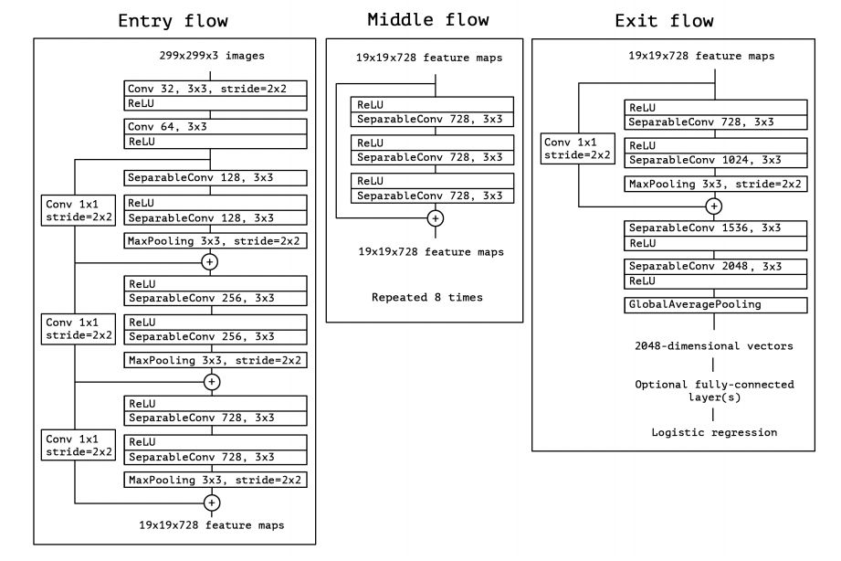
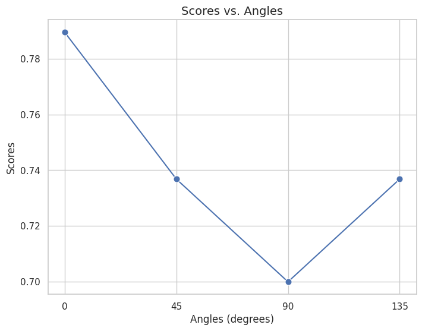
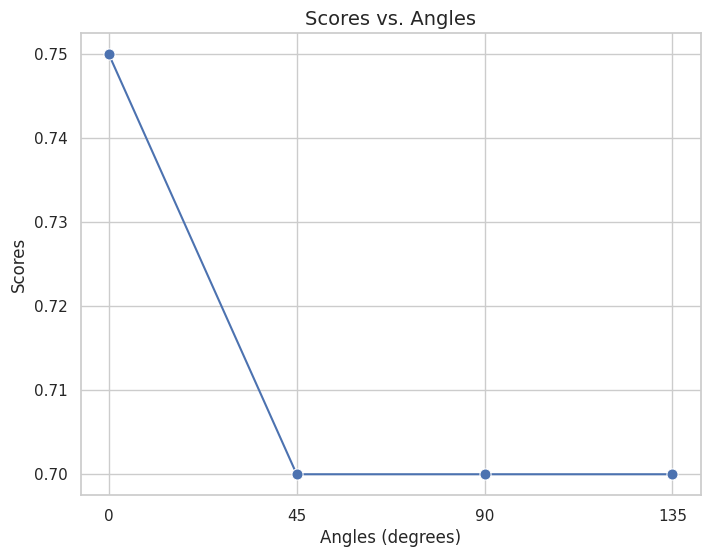
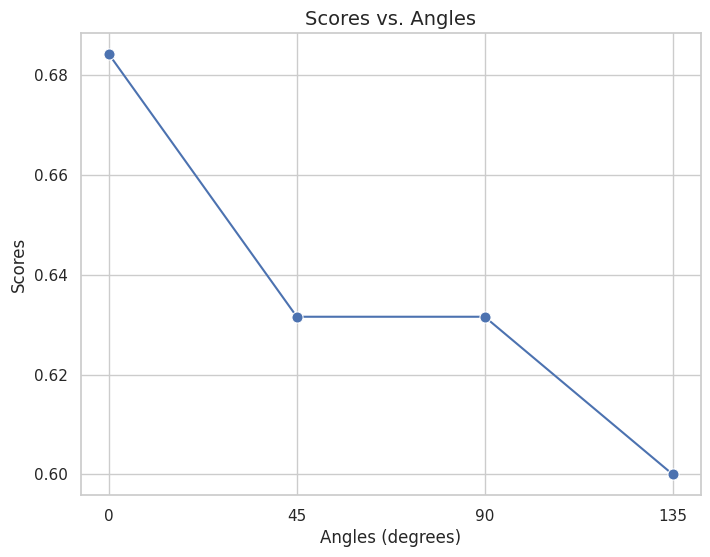
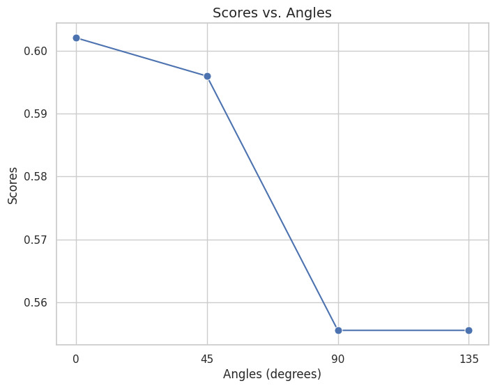

# Breast Cancer Classification

**Classifying mammograms as benign or malignant on the CBIS-DDSM dataset, comparing texture-feature SVMs with deep convolutional networks.**

**Author:** Jen Li Kao

<div align="center">
<table>
  <tr>
    <th>GLCM + SVM pipeline</th>
    <th>Residual CNN (Xception)</th>
  </tr>
  <tr>
    <td align="center"></td>
    <td align="center"></td>
  </tr>
</table>
</div>

---

## Table of contents

1. [Overview](#overview)
2. [Goals](#goals)
3. [Dataset](#dataset)
4. [Approach](#approach)
5. [Results](#results)
6. [Insights](#insights)
7. [Getting started](#getting-started)
8. [Repository structure](#repository-structure)

---

## Overview

Mammography is the primary screening tool for breast cancer, and automated classification can support radiologists in telling benign from malignant findings. This project reproduces and compares three approaches from the literature on the same public dataset:

1. **GLCM + SVM**: hand-crafted texture features with a support vector machine
2. **EfficientNet two-view CNN**: a network that reads both standard mammogram views together
3. **Residual CNN (Xception)**: a deep residual network tuned with Optuna

The project focuses in particular on how **feature normalization** and the **GLCM angle** affect the classical pipeline.

**Key outcomes**

- Reproducing the published GLCM + SVM setup gave only **50 %** accuracy, far below the paper's figures
- Yeo-Johnson normalization made the SVM the most stable, but held-out accuracy stayed at **0.52–0.57**, showing texture statistics alone separate the two classes poorly
- The tuned residual CNN reached **0.80 / 0.78** validation accuracy, clearly ahead of every classical model

---

## Goals

| # | Question | Approach |
| --- | --- | --- |
| 1 | Can published GLCM + SVM results be reproduced? | Re-implement the pipeline on CBIS-DDSM |
| 2 | How much do preprocessing choices matter? | Compare GLCM angles and normalization methods |
| 3 | How do deep models compare? | Train two-view EfficientNet and residual CNN models |

---

## Dataset

[CBIS-DDSM](https://www.cancerimagingarchive.net/collection/cbis-ddsm/) is a curated subset of the Digital Database for Screening Mammography, with 2,620 studies, verified pathology, and region-of-interest (ROI) annotations.

This project uses the **calcification training set** (1,546 ROI cases):

| Class | Cases | Use |
| --- | --- | --- |
| Benign | 528 | Included |
| Malignant | 544 | Included |
| Benign without callback | 474 | Excluded (no diagnostic follow-up) |

The 1,072 remaining cases are split 70 / 30 into training and test sets.

---

## Approach

### 1. GLCM + SVM

**Preprocessing.** DICOM images are converted to PNG, converted to grayscale, and contrast-enhanced with histogram equalization.

**Texture features.** A gray-level co-occurrence matrix (GLCM) with distance 1 and 256 gray levels is computed at **0°, 45°, 90°, and 135°**. Nine features are extracted from each matrix: correlation, homogeneity, contrast, ASM, energy, dissimilarity, variance, maximum probability, and sum average.

**Normalization.** Three settings are compared:

| Method | Effect |
| --- | --- |
| None | Large-magnitude features dominate the SVM margin |
| Standard scaling | Zero mean, unit variance |
| Yeo-Johnson power transform | Reduces skew and handles negative values; most stable in our tests |

**Classifier.** SVM with an RBF kernel, C = 1, γ = 1 / (number of features), and tolerance 0.001. Random Forest (1,500 trees) and XGBoost serve as additional baselines.

### 2. EfficientNet two-view CNN

Each breast is imaged in two views, craniocaudal (CC) and mediolateral oblique (MLO). Following Petrini et al. (2022), a single-view EfficientNet-B0 classifier is extended to read both views at once and trained end-to-end.

- Images resized to 1152 × 896, with the mean training pixel value subtracted
- Augmentation: ±25° rotation, ±20 % zoom, ±12 % shear, ±20 % intensity shift, and horizontal and vertical flips

### 3. Residual CNN (Xception)

The two-view model proved too compute-intensive for full training on the available hardware. We therefore trained an Xception-style residual network, whose shortcut connections ease optimization of deep models. Hyperparameters were tuned with **Optuna**.

---

## Results

### GLCM + SVM

Reproducing the original configuration (45°, no normalization) gave **0.50** accuracy, and nearly every benign case was predicted as malignant (benign recall 0.05). The likely cause is a mismatch in the sample set; our data selection yielded 1,227 images instead of the paper's 1,546.

With Yeo-Johnson normalization:

| GLCM angle | Held-out accuracy | Best cross-validation fold |
| --- | --- | --- |
| 0° | 0.56 | 0.79 |
| 45° | 0.56 | 0.74 |
| 90° | 0.52 | 0.70 |
| 135° | 0.57 | 0.74 |

Random Forest and XGBoost both reached 0.51 held-out accuracy.

The plots below show the best cross-validation fold score per angle for each normalization method. Yeo-Johnson scores highest at every angle, and no normalization scores lowest.

<div align="center">
<table>
  <tr>
    <th>Yeo-Johnson</th>
    <th>Standard scaling</th>
  </tr>
  <tr>
    <td align="center"></td>
    <td align="center"></td>
  </tr>
  <tr>
    <th>No normalization</th>
    <th>10-fold cross-validation, no normalization</th>
  </tr>
  <tr>
    <td align="center"></td>
    <td align="center"></td>
  </tr>
</table>
</div>

### Residual CNN

Hyperparameter configurations (accuracy for the left and right models):

| Configuration | Changes | Train (L / R) | Validation (L / R) |
| --- | --- | --- | --- |
| 1 | Learning rate 1e-3 → 1e-5, 50 → 250 epochs, binary cross-entropy | 0.62 / 1.00 | 0.61 / 0.51 |
| 2 | Average pooling, 5 layers | 0.61 / 0.89 | 0.47 / 0.61 |
| 3 | Dynamic learning rate | 0.84 / 0.65 | 0.63 / 0.53 |
| **4** | **Original setup with grid search** | **0.89 / 0.80** | **0.80 / 0.78** |

Configuration 1 shows clear overfitting (training accuracy 1.00 on the right model, validation 0.51). The tuned original setup generalizes best.

---

## Insights

- **Reproducibility depends on data selection.** Differences in which CBIS-DDSM cases are included can change results dramatically.
- **Normalization matters for classical models.** Distance-based SVMs are sensitive to feature scale; the Yeo-Johnson transform gave the most consistent behavior.
- **Report held-out accuracy, not the best fold.** Best-fold cross-validation scores (up to 0.79) overstate performance; held-out accuracy (≈ 0.56) is the realistic figure.
- **Learned features win.** Residual CNNs capture spatial patterns that global texture statistics miss, at the cost of far more compute.

---

## Getting started

```bash
pip install numpy pandas scikit-learn scikit-image opencv-python pillow xgboost seaborn
```

The GLCM + SVM pipeline runs in this order:

| Step | Script | Purpose |
| --- | --- | --- |
| 1 | [`gray_svm/data_pre.py`](gray_svm/data_pre.py) | Select calcification cases from the CBIS-DDSM metadata |
| 2 | [`gray_svm/jpg_to_png.py`](gray_svm/jpg_to_png.py) | Convert images to PNG |
| 3 | [`gray_svm/image_prepro.py`](gray_svm/image_prepro.py) | Grayscale conversion and histogram equalization |
| 4 | [`gray_svm/GLCM.py`](gray_svm/GLCM.py) | Extract GLCM texture features to CSV |
| 5 | [`gray_svm/SVM.py`](gray_svm/SVM.py) | Train and evaluate the SVM |

[`Training/SVMClassification.ipynb`](Training/SVMClassification.ipynb) runs the normalization and angle experiments in Google Colab. The scripts use absolute local paths; update the input and output paths before running.

---

## Repository structure

```
.
├── gray_svm/                 # Data selection, preprocessing, GLCM features, and SVM
├── Training/                 # Colab notebook for SVM experiments
├── images/                   # README figures
└── Breast Cancer Image Classification Project.pdf   # Full report
```

## License

Released under the [MIT License](LICENSE).
