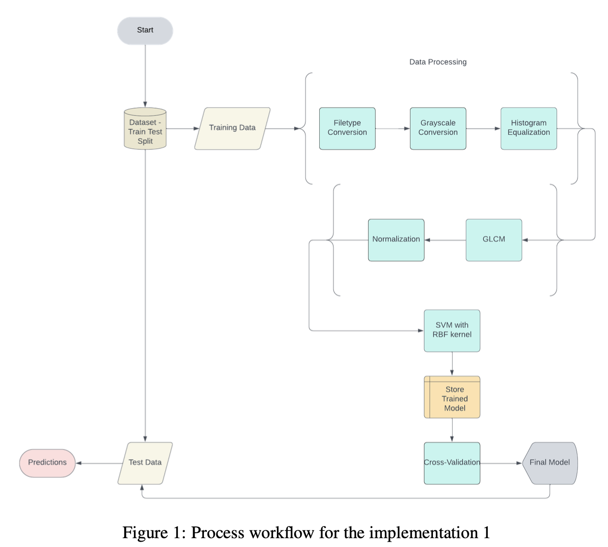

# Breast-Cancer-Classification
A Comparative Study of SVM, CNN, and Transformer Models on the CBIS-DDSM Dataset

## Overview
This project focuses on classifying breast cancer using mammogram images from the CBIS-DDSM dataset. The study implements:

- Support Vector Machines (SVM) with texture-based feature extraction (Gray-Level Co-Occurrence Matrix, GLCM)

- EfficientNet-Based Convolutional Neural Network (CNN) with transfer learning for two-view mammogram classification

- Residual Neural Network (ResNet) for improved feature extraction and classification

## Dataset
The CBIS-DDSM (Curated Breast Imaging Subset of the Digital Database for Screening Mammography) dataset includes:

- 2,620 mammogram images categorized as Normal, Benign, and Malignant

- Region of Interest (ROI) segmentation with verified pathology reports

- DICOM format images, converted to PNG for preprocessing

## Methodology
### 1. Data Preprocessing
- Convert DICOM to PNG
- Grayscale conversion
- Contrast enhancement using histogram equalization
- GLCM-based feature extraction with optimal angle selection
### 2. Feature Normalization Techniques
- Baseline (No Normalization): Poor stability
- Standard Scaling: Mean = 0, Std Dev = 1
- Power Transformer: Maps features to a Gaussian-like distribution
- Yeo-Johnson Transformation: Normalizes both positive and negative values
### 3. Model Implementation
#### Model 1: Support Vector Machines (SVM)
- Uses GLCM features
- Radial Basis Function (RBF) Kernel
- Cross-validation for hyperparameter tuning
#### Model 2: EfficientNet-Based CNN
- Two-view classification (Craniocaudal & Mediolateral Oblique views)
- Pretrained EfficientNet-B0 weights with fine-tuning
- Data Augmentation: Rotation, zoom, shear, intensity shift
#### Model 3: Residual Neural Network (ResNet)
- ResNet architecture for robust feature extraction
- Residual connections improve gradient flow and learning stability

## Workflow
This is the workflow diagram for the breast cancer classification process:

## Evaluation Metrics
- Accuracy, Precision, Recall, F1-Score
- Cross-validation for SVM (varying GLCM angles)
- Hyperparameter tuning using Optuna for CNN and ResNet

